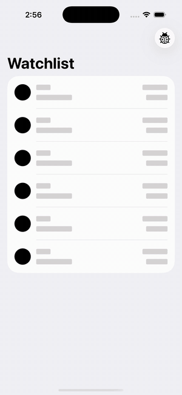

# Demo Trading App (SwiftUI)

Watchlist + buy flow for tokenized stocks and crypto, built on mock price and order services. Includes a 10-second price lock, offline and stale-price handling, and protection against duplicate orders.

- **Progress report:** [docs/PROGRESS.md](docs/PROGRESS.md)
- **Plan:** [PLAN.md](PLAN.md)

## Run

Open `TradingApp.xcodeproj` in Xcode 16+ and run the `TradingApp` scheme on an iOS 17+ simulator. Run the tests with ⌘U (30 Swift Testing cases).

Launch arguments for demos: `-forceOutcome <fill|pendingThenFill|reject|serverError|timeoutPlaced|timeoutNotPlaced>`, `-frozenAsset <SYMBOL>`, `-startOffline`. The same switches are in the in-app ladybug menu.
