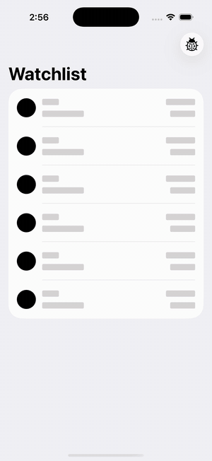
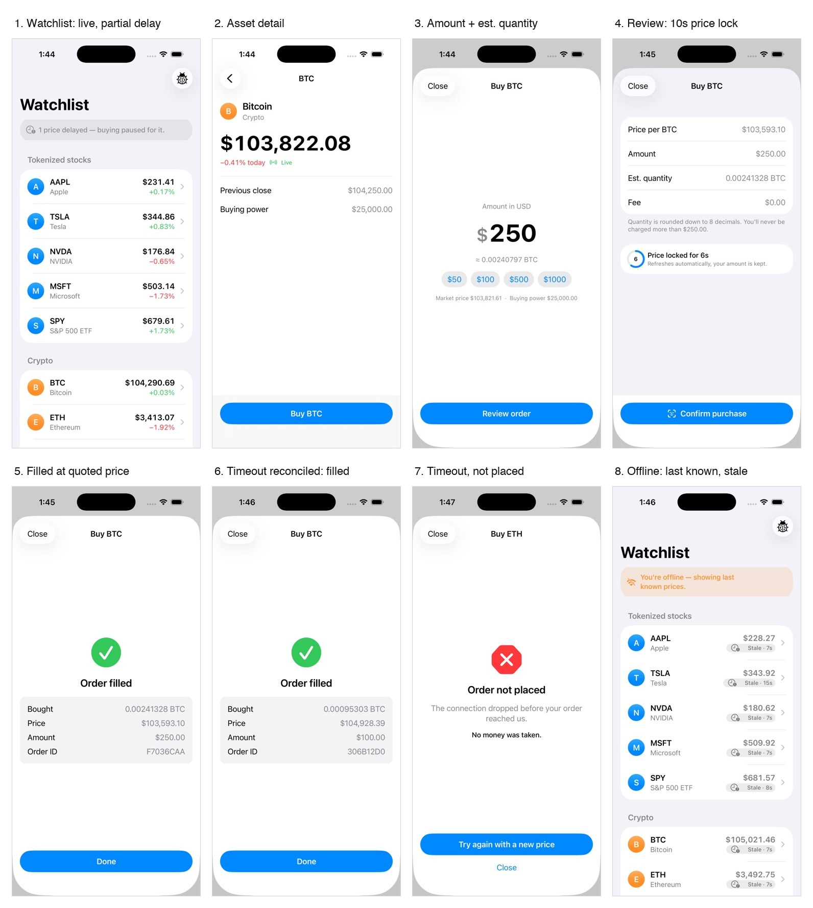

# Trading App — iOS Progress Report

Nov 11, 2026

## Summary

The core feature in PLAN.md works in the iOS Simulator, end to end. That's the watchlist plus the full buy flow (amount → review with a 10s price lock → submit → pending → filled / failed / unknown). Everything runs on mock services in a new Xcode project (`TradingApp.xcodeproj`, iOS 17, SwiftUI, no dependencies). **30 of 30 unit tests pass**, and the app builds with zero warnings on an iPhone 17 Pro simulator (Xcode 26.6).

- **Verified in the simulator:** live prices, the stale badge, the partial-delay and offline banners, a random-outcome buy that filled, a forced timeout that resolved to filled through reconcile with the same order key, and a forced "timeout, not placed" that ended as a clean "Order not placed".
- **One deliberate deviation:** CLAUDE.md says to use `Decimal` for money, but PLAN.md settles on Int64 fixed-point ("as agreed"). I followed PLAN.md. `Decimal` appears only when formatting for display.
- **Fixed during the run:** on launch, assets with no first tick yet were counted as "delayed" in the banner. They now show "Connecting…", and the banner only counts assets that ticked and then went quiet.

## What was built

PLAN.md build steps 1–6 are done. Order logic lives in a pure reducer and two stores, kept separate from the views so a new requirement stays a small diff.

| Layer | Files | What it does |
| --- | --- | --- |
| Domain | `Money.swift`, `Order.swift`, `Asset.swift` | Int64 money in micros, quantity in 1e-8 units rounded down, `Quote` with 10s expiry, 8-state `OrderState` enum (codes 0–7), pure `OrderReducer` |
| Data (mocks) | `PriceFeed.swift`, `OrderAPI.swift`, `Environment.swift` | Random-walk feed with jitter and pauses; `MockOrderAPI` actor with 1–4s latency, weighted outcomes, dedup on `clientOrderID`, stale-quote rejection; injected clock, network monitor, Face ID mock, `withTimeout` |
| Stores | `PriceStore.swift`, `OrderStore.swift` | One price source for every screen, staleness after 5s; order flow per asset, 8s client timeout, reconcile by polling with the same key |
| Features | `Watchlist/*`, `AssetDetail/*` | Watchlist (loading, loaded, stale, partial, offline, empty states), detail, amount entry, review with countdown, status screens |
| Tests | `MoneyTests`, `OrderReducerTests`, `OrderFlowTests` | 30 Swift Testing cases: rounding and overflow, the exact 10.0s boundary, double tap → 1 order, offline confirm → 0 orders, timeout → unknown → filled |

**Duplicate-order guards:** Confirm is only accepted in `review`. The idempotency key is created once, at Confirm. The server deduplicates on that key. A timeout becomes `unknown` (never `failed`) and is reconciled with the same key. Buy stays blocked for that asset until the order settles.

**Demo switches:** the ladybug menu forces offline, a feed disconnect, or the next order outcome. Launch arguments do the same (`-forceOutcome timeoutPlaced`, `-frozenAsset SOL`, `-startOffline`).

## Simulator results

### Demo video

A 44s screen recording of a BTC buy, made with the `-forceOutcome timeoutPlaced -frozenAsset TSLA` launch arguments. In order: the watchlist with TSLA going stale, the detail screen, a $250 amount, the review with its countdown, Confirm, "Placing your order…", then a client timeout after 8s. The app shows "Checking your order…", reconciles with the same order key, and lands on "Order filled" at the locked quote price ($106,212.06) even though the market had moved.

Full-quality MP4: [demo.mp4](demo.mp4)

### Screenshots

All screens were captured on the iPhone 17 Pro simulator from the running app, driven through UI automation. Shots 1–5 are a normal buy with a random outcome. Shots 6–7 force the two timeout paths from the debug menu, and shot 8 toggles offline. In shot 6 the timed-out order resolved to filled through reconcile, and the server still recorded only one order.

The short "Checking your order…" state (between the timeout and the result) comes from a video frame: [screenshots/06-checking-order.jpg](screenshots/06-checking-order.jpg). Individual screenshots are in [`screenshots/`](screenshots/).

## Gaps and next steps

- [ ] **Stubbed:** persistence (in-flight orders are lost if the app is killed), price chart, real biometrics (a 0.6s mock), fee line ($0.00).
- [ ] **Test gap:** no tests yet for `WatchlistViewModel` and `BuyViewModel` validation. CLAUDE.md requires tests for every view model.
- [ ] **UX polish:** the "Checking your order…" screen only shows for about 1.5–2.5s before reconcile resolves it. Consider a minimum display time so users can read it.
- [ ] **Accessibility pass:** labels are in place, but Dynamic Type and VoiceOver haven't been checked on device.
- [ ] **PLAN.md §12:** fill in Done / Stubbed / Next from this report.
